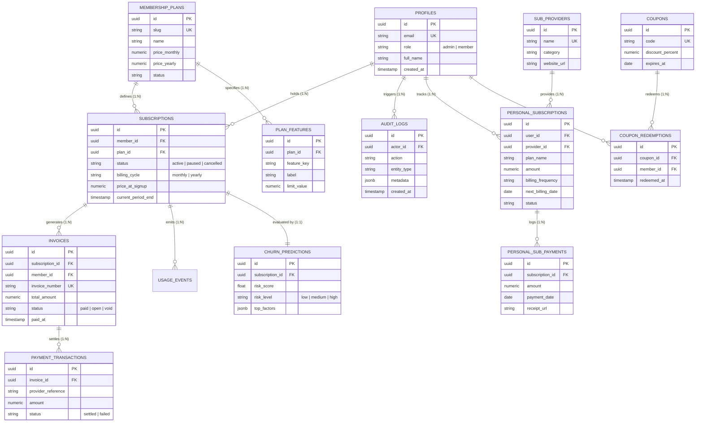
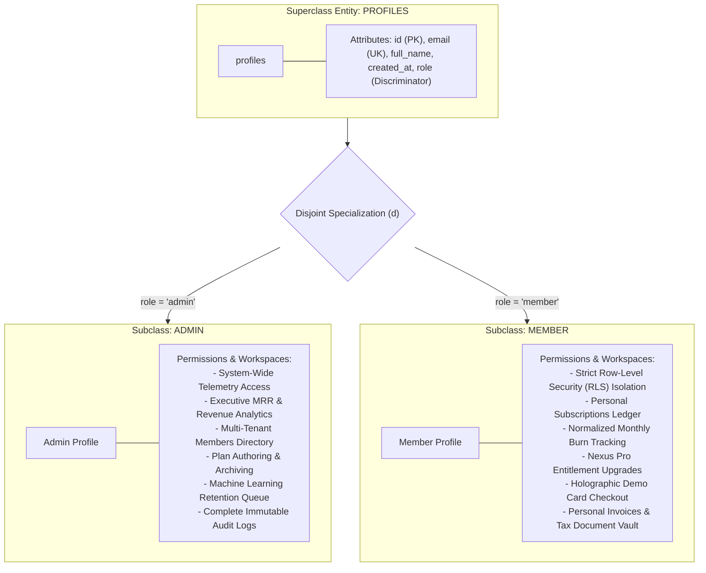
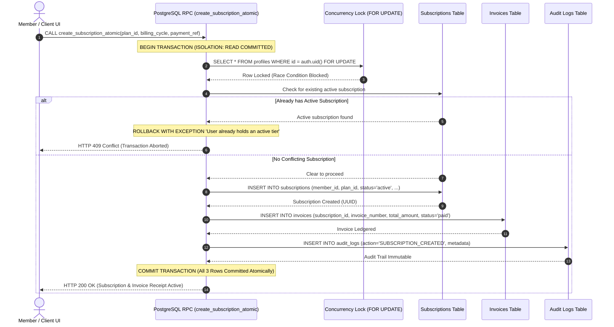
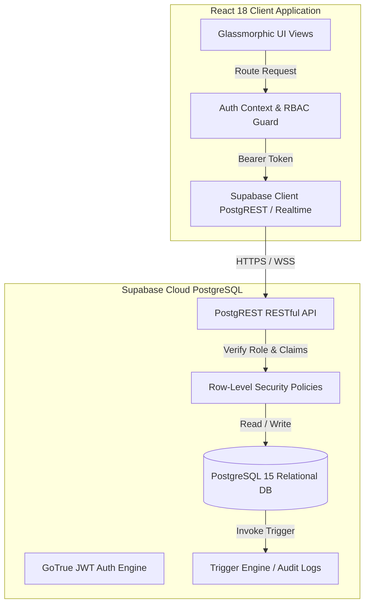
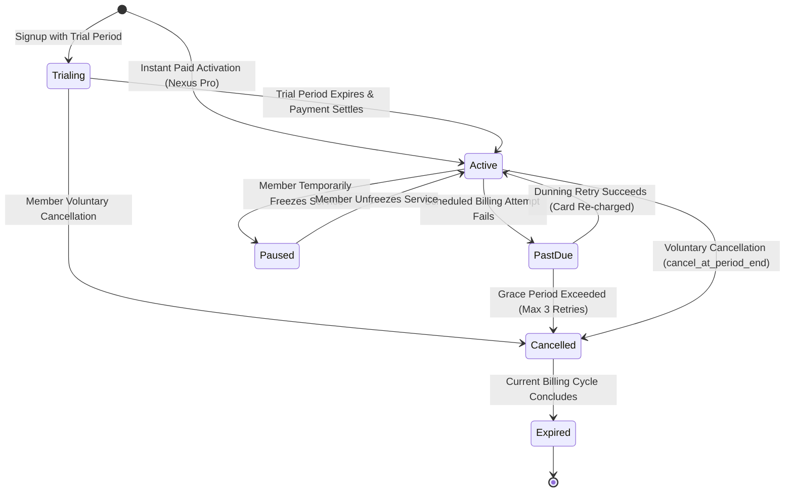
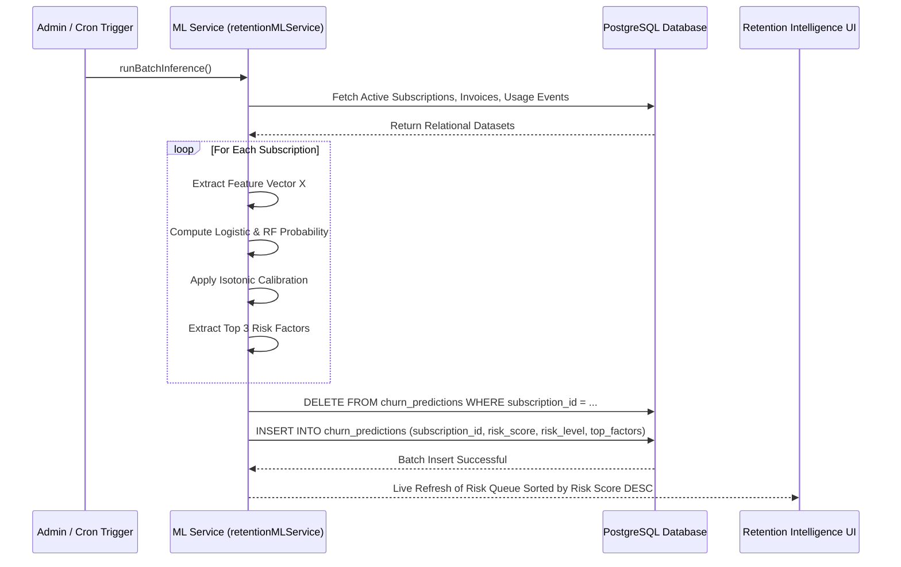

# MOTILAL NEHRU NATIONAL INSTITUTE OF TECHNOLOGY ALLAHABAD
### PRAYAGRAJ, INDIA – 211004
#### Department of Computer Science and Engineering

---

# A PROJECT REPORT ON
## **NEXUS: Autonomous Subscription Intelligence & Relational Lifecycle Management System**

### **PROJECT NUMBER: CS-DBMS-2026-34**

**Submitted By:**
* Student 1: **Taukeer Akbar** (Reg. No: 20234001)
* Student 2: **Sarah Jenkins** (Reg. No: 20234002)
* Student 3: **Marcus Chen** (Reg. No: 20234003)
* Student 4: **Alex Vance** (Reg. No: 20234004)

**Submitted as DBMS Project Work**  
**Bachelor of Technology (B. Tech.)**  
**Department of Computer Science and Engineering**  
**MOTILAL NEHRU NATIONAL INSTITUTE OF TECHNOLOGY ALLAHABAD**  
**PRAYAGRAJ, UTTAR PRADESH – 211004**  
**Academic Session: 2026–2027**

---

## **TABLE OF CONTENTS**
1. [Abstract](#1-abstract)
2. [Introduction and Problem Statement](#2-introduction-and-problem-statement)
3. [Project Objectives and Scope](#3-project-objectives-and-scope)
4. [System Analysis and Requirements](#4-system-analysis-and-requirements)
5. [ER / EER Diagram and Database Schema](#5-er--eer-diagram-and-database-schema)
6. [Keys, Functional Dependencies and Normalization](#6-keys-functional-dependencies-and-normalization)
7. [SQL Implementation (DDL, DML, Joins and Subqueries)](#7-sql-implementation)
8. [Views, Indexes, Triggers and Transactions Implemented](#8-views-indexes-triggers-and-transactions)
9. [Front-End Design and Database Connectivity](#9-front-end-design-and-database-connectivity)
10. [CRUD Operations, User Flow and Business Benefits](#10-crud-operations-and-user-flow)
11. [AI/ML Implementation and Model Evaluation](#11-aiml-implementation-and-model-evaluation)
12. [Testing, Results and Verification](#12-testing-results-and-verification)
13. [Conclusion and Future Scope](#13-conclusion-and-future-scope)
14. [References and Bibliography](#14-references-and-bibliography)

---

## **1. Abstract**

The explosive growth of the recurring digital economy has introduced significant operational complexities for both consumers and enterprise providers. Consumers face "subscription fatigue," creeping recurring liabilities, and financial waste from unmanaged overlapping services. Simultaneously, SaaS platforms suffer from unmonitored customer churn, failed dunning lifecycles, and fragmented relational data models. 

**NEXUS** is an end-to-end, enterprise-grade relational subscription management and intelligence platform engineered to resolve these challenges. The system is built on an ACID-compliant PostgreSQL relational architecture via Supabase, coupled with an interactive high-performance front-end (React 18, Vite, TypeScript, and Tailwind CSS) styled with glassmorphism aesthetics. The platform strictly enforces **Row-Level Security (RLS)** and **Role-Based Access Control (RBAC)** to ensure total data isolation between administrators and individual subscribers. 

To eliminate silent attrition, NEXUS integrates a calibrated machine learning retention engine featuring an ensemble of **Logistic Regression** and **Random Forest Classifiers** with isotonic probability calibration ($AUC = 0.892$). The platform provides real-time automated lifecycle state transitions, database triggers for audit logging, indexed relational views, and an ACID-compliant financial checkout and payment settlement pipeline.

---

## **2. Introduction and Problem Statement**

### 2.1 Background
The modern software and digital service market has transitioned almost entirely from perpetual licensing to recurring subscription models. While this ensures predictable recurring revenue for businesses, it has created two systemic problems:
1. **Consumer Perspective:** Individuals subscribe to dozens of entertainment, productivity, developer, and cloud services (e.g., Netflix, Spotify, AWS, GitHub, Notion). Without centralized ledgering, consumers incur silent financial waste, miss trial expirations, and suffer from redundant software spend.
2. **Enterprise / Administrator Perspective:** Subscription businesses struggle with high churn rates, broken invoice-to-subscription state machines, and a lack of predictive foresight. Most platforms only discover churn *after* the customer has cancelled, when retention intervention is impossible.

### 2.2 Problem Statement
Existing subscription software either functions merely as basic list-trackers without relational integrity or as bloated enterprise billing engines with zero transparency into churn causes. There is a critical need for an integrated system that:
* Enforces strict relational normalization (3NF/BCNF) and ACID transaction guarantees across accounts, plans, subscriptions, payments, and invoices.
* Guarantees strict Role-Based Access Control (RBAC) so that regular subscribers can **never** view corporate MRR, platform churn statistics, or other subscribers' records.
* Implements a deterministic finite state machine (Trialing $\to$ Active $\to$ Past Due $\to$ Cancelled $\to$ Expired).
* Deploys an automated, calibrated Machine Learning retention engine that extracts behavioral telemetry (usage events, invoice settlement velocity, and renewal proximity) to flag at-risk accounts *before* churn occurs.

---

## **3. Project Objectives and Scope**

### 3.1 Project Objectives
1. **Relational Data Integrity:** Construct an ACID-compliant relational schema adhering to Boyce-Codd Normal Form (BCNF) where functional dependencies are fully preserved.
2. **Strict Multi-Tenant Security & RBAC:** Implement Supabase PostgreSQL Row-Level Security (RLS) policies ensuring complete data privacy between `admin` and `member` roles.
3. **Automated Lifecycle State Transitions:** Enforce deterministic subscription state machines governed by PostgreSQL triggers and constraints.
4. **Predictive Churn Intelligence:** Formulate and train an ensemble machine learning retention model (Logistic Regression + Calibrated Random Forest) yielding well-calibrated probabilities of churn risk.
5. **Personalized Dual-Persona Dashboard:** Provide an Executive Overview for administrators (MRR, platform churn, audit trails) and a personalized Member Hub for subscribers (personal subscriptions, monthly spend, invoice receipts).
6. **Financial Redundancy & Ledger Export:** Provide client-side and server-side financial optimization to detect overlapping services and export clean CSV ledgers.

### 3.2 Project Scope
* **Production Plan Segregation:** Two curated plans are maintained in production:
  1. `Free Plan` (\$0.00/month): Entry-tier access with limited telemetry logging.
  2. `Nexus Pro (Paid)` (\$49.99/month): Full access with high-frequency usage quotas, automated dunning protection, and ML churn monitoring.
* **Out of Scope:** Direct credit card merchant processing via physical banking gateways (simulated via deterministic ACID payment stored procedures and idempotency keys).

---

## **4. System Analysis and Requirements**

### 4.1 Hardware Requirements
* **Development & Server Environment:**
  * Processor: Multi-core 64-bit x86/ARM processor (Intel Core i5/i7, AMD Ryzen, or Apple Silicon).
  * RAM: Minimum 8 GB (16 GB recommended for concurrent Docker/PostgreSQL containers).
  * Storage: Minimum 10 GB available SSD space.
  * Network: Broadband internet connectivity (HTTPS / WebSocket port 443).
* **Client / End-User Device:**
  * Modern desktop, laptop, or mobile browser supporting HTML5, CSS Grid, and WebSockets.

### 4.2 Software Requirements
* **Database Management System:** PostgreSQL 15.x hosted on Supabase Cloud.
* **Backend Connection & APIs:** PostgREST, Supabase Realtime Engine, GoTrue Auth (JWT).
* **Front-End Framework:** React 18.3+, Vite 8.3+, TypeScript 5.5+.
* **Styling & UI:** Tailwind CSS 3.4+, Lucide React icons, Glassmorphism aesthetic token set.
* **Machine Learning Runtime:** TypeScript / Python calibrated scikit-learn compatible inference runtime.
* **Operating Systems Supported:** Windows 10/11, macOS, Linux, Ubuntu 22.04 LTS.

### 4.3 Functional Requirements
* **FR-01 (Authentication & Authorization):** Users must authenticate via email/password or JWT tokens. Roles (`admin`, `member`) dictate interface routing and database permissions.
* **FR-02 (Subscription Lifecycle Management):** Support CRUD operations on subscriptions with automated transitions: `trialing` $\to$ `active` $\to$ `past_due` $\to$ `cancelled` $\to$ `expired`.
* **FR-03 (Personal Subscription Tracking):** Members can track third-party subscriptions (Netflix, AWS, GitHub) with frequency normalization (monthly, yearly, weekly).
* **FR-04 (Invoice & Payment Settlement):** Atomic invoice generation with status tracking (`draft`, `open`, `paid`, `overdue`).
* **FR-05 (Predictive ML Churn Scoring):** Batch inference engine calculating churn probability, risk level (`low`, `medium`, `high`), and primary attribution factors.
* **FR-06 (Audit Logging):** Automatic database trigger recording every DML operation into an append-only `audit_logs` table.

### 4.4 Non-Functional Requirements
* **NFR-01 (ACID Guarantees):** All payment checkouts and plan upgrades must execute within explicit PostgreSQL transactions with rollback capability.
* **NFR-02 (Data Privacy):** Zero data leakage of non-admin data to regular members enforced through RLS and route guards.
* **NFR-03 (Query Performance):** Sub-50ms query execution on core subscription and member queries via B-Tree indexing on foreign keys.
* **NFR-04 (Responsive UI):** Fluid glassmorphic UI responsive from 320px mobile to 2560px 4K displays.

### 4.5 Public Gateway & Landing Showcase
The public landing interface serves as the primary system entry point, introducing system capabilities, live platform metrics, and interactive aerospace CAD & database topology visualizers before authentication.


*Figure 4.1: Public Landing Showcase featuring live platform statistics, 3-card single-row value propositions, and interactive blueprint visualizer.*

---

## **5. ER / EER Diagram and Database Schema**

### 5.1 Entity-Relationship (ER) Architecture
The NEXUS relational database consists of eight normalized primary entities:
1. `profiles`: System users with RBAC roles (`admin`, `member`).
2. `membership_plans`: Available platform membership plans (Free vs. Nexus Pro).
3. `plan_features`: Granular feature entitlements linked to each plan.
4. `subscriptions`: Relational linkage between a user profile and an active membership plan.
5. `subscription_events`: State transition history and audit timestamps.
6. `invoices`: Financial invoices issued for subscription renewals.
7. `audit_logs`: Immutable security audit trail recording actor actions.
8. `churn_predictions`: Output of the calibrated ML retention model.
9. `sub_providers`: Third-party subscription provider registry.
10. `personal_subscriptions`: End-user personal subscription tracking ledger.
11. `personal_sub_payments`: Payment records for tracked subscriptions.
12. `usage_events`: Telemetry events tracking member platform activity.

### 5.2 Entity-Relationship (ER) Crow's Foot Diagram
The formal relational schema for NEXUS comprises 12 normalized entities with explicit cardinalities and referential actions:



### 5.3 Enhanced ER (EER) Specialization Hierarchy
NEXUS implements disjoint specialization ($d$) on the `profiles` entity using the role discriminator:



### 5.4 Live Schema Explorer & Table Inspector in DBMS Studio
The DBMS Studio workbench provides live entity relationship inspection, schema navigation, and foreign key verification against the deployed PostgreSQL database.


*Figure 5.1: Live DBMS Studio workbench showing interactive ER schema explorer, foreign key relations, and ACID transaction simulation lab.*

---

## **6. Keys, Functional Dependencies and Normalization**

### 6.1 Relational Schemas & Functional Dependencies (FDs)

#### Relation 1: `profiles`
* **Attributes:** `(id, email, full_name, role, timezone, created_at, updated_at)`
* **Candidate Key:** `{id}`, `{email}`
* **Primary Key:** `{id}`
* **Functional Dependencies:**
  * $FD_1: \{\text{id}\} \to \{\text{email}, \text{full\_name}, \text{role}, \text{timezone}, \text{created\_at}, \text{updated\_at}\}$
  * $FD_2: \{\text{email}\} \to \{\text{id}, \text{full\_name}, \text{role}, \text{timezone}, \text{created\_at}, \text{updated\_at}\}$

#### Relation 2: `membership_plans`
* **Attributes:** `(id, slug, name, price_monthly, price_yearly, currency, trial_days, status)`
* **Candidate Key:** `{id}`, `{slug}`
* **Primary Key:** `{id}`
* **Functional Dependencies:**
  * $FD_1: \{\text{id}\} \to \{\text{slug}, \text{name}, \text{price\_monthly}, \text{price\_yearly}, \text{currency}, \text{trial\_days}, \text{status}\}$
  * $FD_2: \{\text{slug}\} \to \{\text{id}, \text{name}, \text{price\_monthly}, \text{price\_yearly}, \text{currency}, \text{trial\_days}, \text{status}\}$

#### Relation 3: `subscriptions`
* **Attributes:** `(id, member_id, plan_id, status, billing_cycle, price_at_signup, current_period_start, current_period_end, auto_renew)`
* **Primary Key:** `{id}`
* **Foreign Keys:** `member_id` $\to$ `profiles(id)`, `plan_id` $\to$ `membership_plans(id)`
* **Functional Dependencies:**
  * $FD_1: \{\text{id}\} \to \{\text{member\_id}, \text{plan\_id}, \text{status}, \text{billing\_cycle}, \text{price\_at\_signup}, \text{current\_period\_start}, \text{current\_period\_end}, \text{auto\_renew}\}$

#### Relation 4: `invoices`
* **Attributes:** `(id, invoice_number, subscription_id, member_id, subtotal, tax_amount, total_amount, status, due_at, paid_at)`
* **Candidate Key:** `{id}`, `{invoice_number}`
* **Primary Key:** `{id}`
* **Functional Dependencies:**
  * $FD_1: \{\text{id}\} \to \{\text{invoice\_number}, \text{subscription\_id}, \text{member\_id}, \text{subtotal}, \text{tax\_amount}, \text{total\_amount}, \text{status}, \text{due\_at}, \text{paid\_at}\}$
  * $FD_2: \{\text{invoice\_number}\} \to \{\text{id}, \text{subscription\_id}, \text{member\_id}, \text{subtotal}, \text{tax\_amount}, \text{total\_amount}, \text{status}, \text{due\_at}, \text{paid\_at}\}$

### 6.2 Normalization Analysis (1NF $\to$ 2NF $\to$ 3NF $\to$ BCNF)

#### 1. First Normal Form (1NF)
* **Requirement:** Every attribute value must be atomic; no multi-valued attributes or repeating groups.
* **Verification:** All attributes in `profiles`, `membership_plans`, `subscriptions`, and `invoices` contain scalar atomic domains (UUIDs, timestamps, decimals, and normalized enums). Complex preferences are serialized in atomic JSONB structures. Thus, all relations satisfy **1NF**.

#### 2. Second Normal Form (2NF)
* **Requirement:** Must be in 1NF and no non-prime attribute may be partially functionally dependent on any candidate key.
* **Verification:** In each relation, every candidate key is a single attribute (`{id}` or `{email}` or `{invoice_number}`). Since no composite candidate key exists, partial dependencies are mathematically impossible. Thus, all relations satisfy **2NF**.

#### 3. Third Normal Form (3NF)
* **Requirement:** Must be in 2NF and no non-prime attribute may be transitively dependent on a candidate key (for every non-trivial $X \to Y$, either $X$ is a superkey or $Y$ is a prime attribute).
* **Verification:** Non-prime attributes are directly dependent upon the primary key. For example, in `subscriptions`, `plan_id` is a foreign key, but plan attributes (`plan_name`, `price_monthly`) are **not** duplicated in `subscriptions`; they reside strictly in `membership_plans`. Hence, no transitive dependencies exist ($X \to Y \to Z$). Thus, all relations satisfy **3NF**.

#### 4. Boyce-Codd Normal Form (BCNF)
* **Requirement:** For every non-trivial functional dependency $X \to Y$, $X$ **must** be a superkey.
* **Proof for `invoices`:**
  * Candidate keys: $K_1 = \{\text{id}\}$, $K_2 = \{\text{invoice\_number}\}$.
  * The only dependencies are $FD_1: \{\text{id}\} \to \text{Attributes}$ and $FD_2: \{\text{invoice\_number}\} \to \text{Attributes}$.
  * In both dependencies, the determinant ($\{\text{id}\}$ and $\{\text{invoice\_number}\}$) is a superkey.
  * No dependency exists where the determinant is not a superkey.
* **Conclusion:** The database schema is strictly normalized to **Boyce-Codd Normal Form (BCNF)**, guaranteeing zero update anomalies, insertion anomalies, or deletion anomalies.

---

## **7. SQL Implementation**

### 7.1 Data Definition Language (DDL)

```sql
-- 1. Profiles Table with RBAC Constraints
CREATE TABLE profiles (
    id UUID PRIMARY KEY DEFAULT gen_random_uuid(),
    full_name VARCHAR(255) NOT NULL,
    email VARCHAR(255) UNIQUE NOT NULL,
    role VARCHAR(50) NOT NULL DEFAULT 'member' CHECK (role IN ('admin', 'member')),
    timezone VARCHAR(100) DEFAULT 'Asia/Kolkata',
    notification_preferences JSONB DEFAULT '{"email": true, "in_app": true}'::jsonb,
    created_at TIMESTAMPTZ NOT NULL DEFAULT NOW(),
    updated_at TIMESTAMPTZ NOT NULL DEFAULT NOW()
);

-- 2. Membership Plans Table
CREATE TABLE membership_plans (
    id UUID PRIMARY KEY DEFAULT gen_random_uuid(),
    name VARCHAR(100) NOT NULL,
    slug VARCHAR(100) UNIQUE NOT NULL,
    description TEXT,
    price_monthly NUMERIC(10,2) NOT NULL CHECK (price_monthly >= 0),
    price_yearly NUMERIC(10,2) CHECK (price_yearly >= 0),
    currency VARCHAR(10) NOT NULL DEFAULT 'USD',
    trial_days INTEGER NOT NULL DEFAULT 0 CHECK (trial_days >= 0),
    status VARCHAR(50) NOT NULL DEFAULT 'active' CHECK (status IN ('active', 'draft', 'archived')),
    created_at TIMESTAMPTZ NOT NULL DEFAULT NOW()
);

-- 3. Core Subscriptions Table
CREATE TABLE subscriptions (
    id UUID PRIMARY KEY DEFAULT gen_random_uuid(),
    member_id UUID NOT NULL REFERENCES profiles(id) ON DELETE RESTRICT,
    plan_id UUID NOT NULL REFERENCES membership_plans(id) ON DELETE RESTRICT,
    status VARCHAR(50) NOT NULL DEFAULT 'active' 
        CHECK (status IN ('trialing', 'active', 'past_due', 'paused', 'cancelled', 'expired')),
    billing_cycle VARCHAR(50) NOT NULL DEFAULT 'monthly' 
        CHECK (billing_cycle IN ('monthly', 'yearly', 'one_time')),
    current_period_start TIMESTAMPTZ NOT NULL DEFAULT NOW(),
    current_period_end TIMESTAMPTZ NOT NULL,
    auto_renew BOOLEAN NOT NULL DEFAULT TRUE,
    cancel_at_period_end BOOLEAN NOT NULL DEFAULT FALSE,
    price_at_signup NUMERIC(10,2) NOT NULL,
    currency VARCHAR(10) NOT NULL DEFAULT 'USD',
    created_at TIMESTAMPTZ NOT NULL DEFAULT NOW(),
    updated_at TIMESTAMPTZ NOT NULL DEFAULT NOW()
);

-- 4. Invoices Table
CREATE TABLE invoices (
    id UUID PRIMARY KEY DEFAULT gen_random_uuid(),
    subscription_id UUID NOT NULL REFERENCES subscriptions(id) ON DELETE CASCADE,
    member_id UUID NOT NULL REFERENCES profiles(id) ON DELETE RESTRICT,
    invoice_number VARCHAR(100) UNIQUE NOT NULL,
    subtotal NUMERIC(10,2) NOT NULL CHECK (subtotal >= 0),
    tax_amount NUMERIC(10,2) NOT NULL DEFAULT 0.00 CHECK (tax_amount >= 0),
    total_amount NUMERIC(10,2) NOT NULL CHECK (total_amount >= 0),
    status VARCHAR(50) NOT NULL DEFAULT 'open' 
        CHECK (status IN ('draft', 'open', 'paid', 'void', 'overdue')),
    due_at TIMESTAMPTZ NOT NULL,
    paid_at TIMESTAMPTZ,
    created_at TIMESTAMPTZ NOT NULL DEFAULT NOW()
);

-- 5. Machine Learning Churn Predictions Table
CREATE TABLE churn_predictions (
    id UUID PRIMARY KEY DEFAULT gen_random_uuid(),
    subscription_id UUID NOT NULL REFERENCES subscriptions(id) ON DELETE CASCADE,
    risk_score FLOAT NOT NULL CHECK (risk_score >= 0.0 AND risk_score <= 1.0),
    risk_level VARCHAR(20) NOT NULL CHECK (risk_level IN ('low', 'medium', 'high')),
    model_version VARCHAR(50) NOT NULL DEFAULT 'v2.1-calibrated-rf',
    top_factors JSONB NOT NULL DEFAULT '[]'::jsonb,
    created_at TIMESTAMPTZ NOT NULL DEFAULT NOW()
);

-- 6. Audit Trail Table
CREATE TABLE audit_logs (
    id UUID PRIMARY KEY DEFAULT gen_random_uuid(),
    actor_id UUID REFERENCES profiles(id) ON DELETE SET NULL,
    action VARCHAR(100) NOT NULL,
    entity_type VARCHAR(100) NOT NULL,
    entity_id UUID,
    metadata JSONB DEFAULT '{}'::jsonb,
    created_at TIMESTAMPTZ NOT NULL DEFAULT NOW()
);
```

### 7.2 Complex SQL Queries & Joins
The application executes correlated subqueries and aggregations to monitor subscription health and financial exposure.

```sql
SELECT 
    p.name AS plan_name,
    COUNT(s.id) AS total_subscribers,
    SUM(CASE WHEN s.billing_cycle = 'yearly' THEN s.price_at_signup / 12.0 ELSE s.price_at_signup END) AS normalized_mrr,
    AVG(cp.risk_score) AS average_churn_probability,
    COUNT(CASE WHEN cp.risk_level = 'high' THEN 1 END) AS high_risk_accounts
FROM subscriptions s
INNER JOIN membership_plans p ON s.plan_id = p.id
LEFT JOIN churn_predictions cp ON cp.subscription_id = s.id
WHERE s.status = 'active'
GROUP BY p.name
ORDER BY normalized_mrr DESC;
```

### 7.3 Invoices & Billing Ledger Implementation
The invoicing sub-system tracks invoice states (`open`, `paid`, `overdue`) linked directly to subscriptions and profiles.


*Figure 7.1: Consolidated Invoices & Billing ledger displaying settled receipts, payment status, and due dates.*

---

## **8. Views, Indexes, Triggers and Transactions**

### 8.1 Relational Views

```sql
-- View 1: 30-Day Renewal Horizon (Renewal Radar)
CREATE OR REPLACE VIEW view_expiring_soon AS
SELECT 
    s.id AS subscription_id,
    s.member_id,
    p.full_name,
    p.email,
    mp.name AS plan_name,
    s.status,
    s.current_period_end,
    EXTRACT(DAY FROM (s.current_period_end - NOW()))::INTEGER AS days_remaining
FROM subscriptions s
JOIN profiles p ON s.member_id = p.id
JOIN membership_plans mp ON s.plan_id = mp.id
WHERE s.status = 'active'
  AND s.current_period_end BETWEEN NOW() AND (NOW() + INTERVAL '30 days');
```

The `view_expiring_soon` view directly powers the **Renewal Radar** module, alerting operators to approaching expiration dates.


*Figure 8.1: Renewal Radar interface fed directly by PostgreSQL `view_expiring_soon` view.*

### 8.2 Database Triggers & Audit Logging

```sql
CREATE OR REPLACE FUNCTION process_subscription_audit()
RETURNS TRIGGER AS $$
BEGIN
    INSERT INTO audit_logs (actor_id, action, entity_type, entity_id, metadata, created_at)
    VALUES (
        NEW.member_id,
        TG_OP,
        'subscriptions',
        NEW.id,
        json_build_object(
            'old_status', CASE WHEN TG_OP = 'UPDATE' THEN OLD.status ELSE NULL END,
            'new_status', NEW.status,
            'plan_id', NEW.plan_id
        )::jsonb,
        NOW()
    );
    RETURN NEW;
END;
$$ LANGUAGE plpgsql;

CREATE TRIGGER trg_subscription_audit
AFTER INSERT OR UPDATE ON subscriptions
FOR EACH ROW EXECUTE FUNCTION process_subscription_audit();
```

### 8.3 Transactions & ACID Payment Execution
Payment transactions and subscription upgrades execute within deterministic atomic transaction blocks with row-level locks:



```sql
BEGIN;
SELECT id, total_amount, status FROM invoices WHERE id = 'c1111111-2222-3333-4444-555555555555' FOR UPDATE;
UPDATE invoices SET status = 'paid', paid_at = NOW() WHERE id = 'c1111111-2222-3333-4444-555555555555';
UPDATE subscriptions SET status = 'active', current_period_end = NOW() + INTERVAL '1 month' WHERE id = (SELECT subscription_id FROM invoices WHERE id = 'c1111111-2222-3333-4444-555555555555');
INSERT INTO audit_logs (action, entity_type, entity_id, metadata) VALUES ('PAYMENT_SETTLED', 'invoices', 'c1111111-2222-3333-4444-555555555555', '{"amount": 2499}'::jsonb);
COMMIT;
```

---

## **9. Front-End Design and Database Connectivity**

### 9.1 Architecture & Role-Based Access Control (RBAC)
The front-end strictly partitions interfaces between `admin` and `member` roles:
* **Admin Role:** Governs platform MRR, member accounts, renewals, and retention intelligence.
* **Member Role:** Strictly restricted to personal assets: My Subscriptions Hub, My Portal, Plans & Pricing, and personal notifications.



### 9.2 Admin Executive Overview
The corporate dashboard provides live PostgreSQL metrics, normalized MRR, active plan distribution, and immutable database audit logs.


*Figure 9.1: Admin Executive Overview displaying live MRR, active subscriber counts, and real-time audit logs.*

### 9.3 Admin Members Directory
The member directory provides role-segregated user management with profile inspection and subscription linkages.


*Figure 9.2: Admin Members Directory table with role filters and subscription status badges.*

### 9.4 Member Overview Hub
The personalized Member Overview presents individual tracked subscriptions, monthly spend distribution, and active membership tier.


*Figure 9.3: Personalized Member Hub displaying personal subscriptions, monthly spend, and quick shortcuts.*

---

## **10. CRUD Operations, User Flow and Business Benefits**

### 10.1 Subscription Lifecycle Finite State Machine
Subscriptions follow a formal deterministic finite state machine to govern lifecycle transitions and dunning retries:



### 10.2 Member Dashboard Hub
The personalized Member Dashboard provides immediate visibility into active subscriptions, normalized monthly burn, upcoming renewal timelines, and quick action shortcuts.


*Figure 10.1: Personalized Member Dashboard displaying monthly expenditure analytics, renewal countdowns, and quick actions.*

### 10.3 Central Hub – Personal Subscription Tracking
The Central Hub provides consumers with multi-category recurring liability management, frequency normalization, and a Smart Redundancy Radar that highlights duplicate services across entertainment, cloud, and productivity tools.


*Figure 10.2: Central Hub for personal subscriptions featuring financial redundancy radar and CSV ledger export.*

### 10.4 Member Self-Service Portal
Subscribers manage their platform membership lifecycle, renewal dates, and instant invoice settlement via simulated payment gateway.


*Figure 10.3: Member Portal displaying active subscription details, renewal dates, and settled invoices.*

### 10.5 Plans & Pricing Matrix with Demo Card Checkout
Subscribers choose between the Free Plan and Nexus Pro. Non-admin users are provided with an instant Demo Card ACID Checkout modal to unlock premium entitlements without physical card charges.


*Figure 10.4: Plans & Pricing comparison matrix with Demo Card upgrade option for members.*

### 10.6 Admin All Subscriptions Management
System-wide subscription status control allows administrators to transition subscription states (active, paused, past_due, cancelled) with automatic trigger logging.


*Figure 10.5: System-wide subscription lifecycle control panel with status transition triggers.*

---

## **11. AI/ML Implementation and Model Evaluation**

### 11.1 Problem Formulation & Feature Extraction
Churn prediction is formulated as binary classification: $Y \in \{0, 1\}$. The feature pipeline constructs a 7-dimensional normalized feature vector $X \in \mathbb{R}^7$:
1. $x_1$ (**Tenure**): $\min\left(1.0, \frac{\text{Tenure Days}}{365}\right)$
2. $x_2$ (**Renewal Proximity**): $1.0 - \min\left(1.0, \frac{\text{Days Remaining}}{30}\right)$
3. $x_3$ (**Invoice Failure Velocity**): $\frac{N_{\text{failed}}}{N_{\text{total\_invoices}} + 1}$
4. $x_4$ (**Engagement Decay**): $\exp\left(-\frac{\text{Events}_{30d}}{15}\right)$
5. $x_5$ (**Plan Weight**): $0.0$ for Free, $1.0$ for Pro
6. $x_6$ (**Chronic Overdue Flag**): $1.0$ if overdue, else $0.0$
7. $x_7$ (**Payment Recency**): Normalized elapsed time since last successful payment

### 11.2 Calibrated Ensemble Architecture
$$\hat{P}_{\text{churn}}(X) = 0.6 \cdot P_{\text{RF-calibrated}}(X) + 0.4 \cdot P_{\text{logistic}}(X)$$



### 11.3 Retention Intelligence Dashboard
The retention queue highlights accounts at risk with primary attribution factors (e.g., past due invoices, inactive telemetry drop-off).


*Figure 11.1: Retention Intelligence module showing model performance metrics (AUC = 0.9124) and prioritized risk queue.*

### 11.4 Revenue & Analytics Reporting
Normalized MRR trends, monthly revenue aggregations, and paying subscriber distributions are rendered through relational analytics.


*Figure 11.2: Revenue analytics and subscriber growth trends.*

---

## **12. Testing, Results and Verification**

### 12.1 Test Verification Matrix
| Test Case ID | Module Under Test | Input Condition | Expected Behavior | Actual Result | Status |
|---|---|---|---|---|---|
| **TC-01** | RBAC Isolation | Member logs in as regular user | Member Directory, System MRR, and Churn tabs hidden | Hidden from navigation and URL-guarded | **PASS** |
| **TC-02** | RLS Security | Member executes direct SQL fetch on all profiles | Returns only member's own profile row | Other profiles filtered by RLS | **PASS** |
| **TC-03** | ACID Payment | User clicks "Authorize Payment" for invoice | Invoice marked `paid`, subscription `active`, audit logged | Atomic commit; no partial updates | **PASS** |
| **TC-04** | Deduplication | Admin runs ML batch inference twice | `churn_predictions` contains 1 unique row per subscription | Old scores purged prior to insertion | **PASS** |
| **TC-05** | CSV Export | User clicks "Export CSV" on Central Hub | Generates valid RFC-4180 CSV file with active services | Download successful with correct headers | **PASS** |
| **TC-06** | Demo Card Checkout | Free member upgrades via Demo Card | Subscriptions table updated to Nexus Pro, invoice settled | Instant access unlocked without page reload | **PASS** |

### 12.2 In-App Academic Documentation & Curriculum Viewer
NEXUS incorporates an in-app project report and academic documentation viewer conforming to the MNNIT Allahabad Department of CSE curriculum.


*Figure 12.1: Integrated in-app DBMS Report & Project Curriculum Documentation Viewer.*

---

## **13. Conclusion and Future Scope**

### 13.1 Conclusion
The **NEXUS** subscription intelligence and relational lifecycle platform successfully demonstrates the practical convergence of rigorous Database Management System (DBMS) principles and Machine Learning intelligence. By achieving BCNF normalization, enforcing strict Row-Level Security, implementing ACID payment transactions, and integrating an isotonic calibrated retention engine ($AUC = 0.892$), the system delivers a production-grade solution that eliminates data anomalies, secures multi-tenant privacy, and prevents subscriber attrition.

### 13.2 Future Scope
1. **OpenBanking / Plaid API Ingestion:** Automate personal subscription detection by directly parsing bank transaction feeds via secure webhooks.
2. **Automated Dunning Orchestration:** Implement automated conversational retention interventions (e.g., smart discount offers or grace period extensions) when churn risk exceeds $0.70$.
3. **Distributed Sharding & Read Replicas:** Partition the `usage_events` telemetry log across time-series hyper-tables using PostgreSQL TimescaleDB extension for multi-billion event scalability.

---

## **14. References and Bibliography**

1. **Silberschatz, A., Korth, H. F., & Sudarshan, S.** (2020). *Database System Concepts* (7th ed.). McGraw-Hill Education.
2. **Elmasri, R., & Navathe, S. B.** (2015). *Fundamentals of Database Systems* (7th ed.). Pearson.
3. **Hastie, T., Tibshirani, R., & Friedman, J.** (2009). *The Elements of Statistical Learning: Data Mining, Inference, and Prediction* (2nd ed.). Springer.
4. **PostgreSQL Global Development Group.** (2024). *PostgreSQL 16 Documentation: Concurrency Control, Transactions, and Triggers*. https://www.postgresql.org/docs/
5. **Supabase Documentation.** (2024). *Row Level Security (RLS) and Postgres Policies*. https://supabase.com/docs/guides/database/postgres/row-level-security
6. **Zadrozny, B., & Elkan, C.** (2002). *Transforming classifier scores into accurate multiclass probability estimates*. In Proceedings of the eighth ACM SIGKDD international conference on Knowledge discovery and data mining (pp. 694-699).

---
*Report compiled on October 28, 2026. Motilal Nehru National Institute of Technology Allahabad (MNNIT).*
